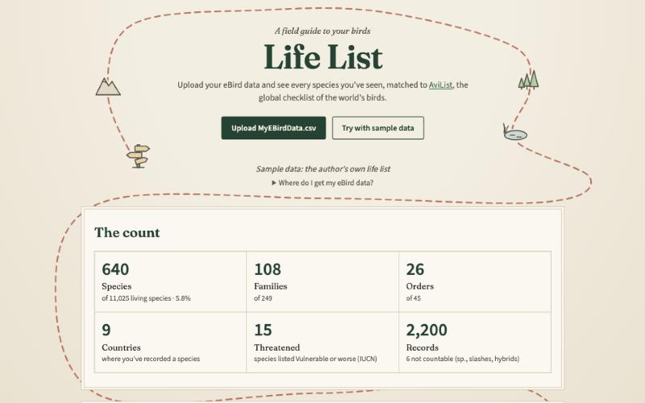
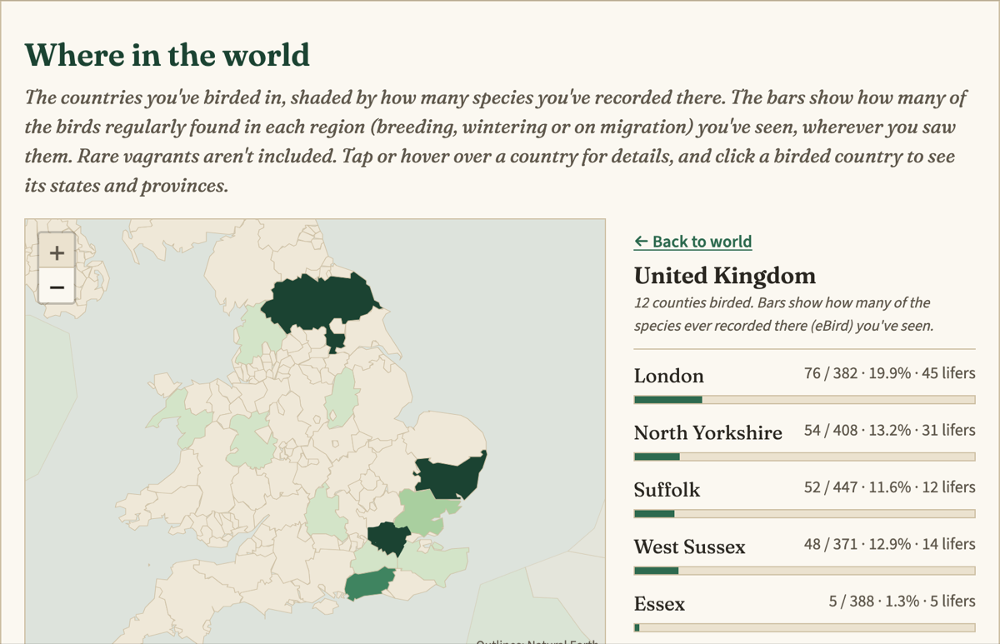

# Life List: a field guide to your birds

A bird-watching life list that matches your [eBird](https://ebird.org) sightings to [AviList](https://www.avilist.org/), the new global checklist of the world's birds, with two AI features built so that the AI can't get things quietly wrong.

**[Try the dashboard →](https://milojacksonbrown.github.io/World-Bird-List/)**
Upload your own eBird data, or press *Try with sample data* to see mine.

It comes in two forms that share the same code:

| | Google Sheets version | Web dashboard |
|---|---|---|
| For | Me: a permanent, editable life list | Anyone with an eBird account |
| Data | Kept in my Google Drive, updated daily | Read in the visitor's browser, never uploaded |
| AI | Name Fixes assistant | Name Fixes, plus *Ask your list* |



---

## The problem

eBird and AviList don't always agree on what counts as a species. AviList might treat the Hooded Crow as part of the Carrion Crow, for example, or split one eBird species into two. Any eBird name with no exact AviList match falls out of the count until someone looks it up and fixes it by hand. That's slow, and typos are easy.

Life lists are also full of questions that a spreadsheet makes awkward to answer: *Which families have I barely touched? What was my best year? What have I seen in Thailand?*

## What it does

- **The count:** species, families, orders and countries seen, as a share of the world's living birds, plus threatened species (IUCN Vulnerable or worse).
- **Where in the world:** a map of countries birded, shaded by species recorded, and bars showing how much of each region's birds you've seen. Click a country to zoom into its states and provinces (counties in the UK, France, Ireland and Indonesia), shaded by species, with species, lifers and the % of the species eBird has recorded there.
- **Through the years:** lifers and species by year and by month (for seasonality), with checklists as a guide to how much birding was done.
- **Latest lifers:** the first time each species was seen, with a search box and a field-guide silhouette of each bird's body shape (heron, wader, owl, finch…). All 250 AviList families are mapped to one of 32 shapes, and a test checks none is missing.
- **Names to check:** every eBird name that doesn't match AviList, with an AI-assisted suggestion you can accept, change or ignore.
- **Ask your list:** questions in plain English, answered from your own data, with the same silhouettes beside species, families and orders.



*Clicking the United Kingdom: each county is shaded by species seen, and the bars show the share of the species ever recorded there.*

The species totals come from eBird's API. A small tool (`tools/fetch-region-totals.js`) asked for every country, state and county once, about 4,300 requests, and saved only the counts (52 KB). The site reads that file, so visitors never call eBird and my key isn't needed or exposed.

## The AI features, and how they're kept honest

Both features follow one rule: **the AI proposes, ordinary code verifies.** The AI never edits data and never answers from its own memory. It makes a choice from a fixed set of options, and code checks that choice before anything happens.

### 1. Name Fixes assistant

1. **String matching first, no AI.** The unmatched name is compared with all 11,000 AviList names, ignoring case, accents, hyphens and spelling variants (Grey/Gray). Near-identical matches are settled here, for free.
2. **AviList's own answer, no AI.** Many names eBird treats as a species but AviList doesn't are listed in AviList as a *subspecies*. eBird's Hooded Crow (*Corvus cornix*) is AviList's *Corvus corone **cornix***, part of Carrion Crow. If exactly one species in the genus has a subspecies of that name, that's the answer, with High confidence and the reason shown. This solved every unmatched name in my own eBird data, instantly.
3. **A shortlist** (only if there's still no answer). The 10 most similar names, plus 5 species from the same genus.
4. **The AI picks from the shortlist, or says "none".** It sees only bird names. Any answer that isn't a shortlist number is rejected.
5. **Confidence comes from agreement, not from the AI.** It's *High* when string matching and the AI agree, *Medium* when only one method finds a match, and *Low* when they disagree. AI models are poor judges of their own certainty, so I don't ask the AI how sure it is.
6. **Nothing changes until I accept.** I can also pick any other candidate, or search AviList myself.

Example: for *Hooded Crow (Corvus cornix)*, string matching guesses Common Raven (same genus, similar letters). Before step 2 existed, Gemini picked Carrion Crow, which is right, but because the two methods disagreed the suggestion was only **Low** confidence. A smaller backup model got it wrong. Step 2 now finds the answer in AviList's own subspecies list: instant, free and certain.

**Lesson: the best AI feature can be less AI.** The AI is now only used for the rare names that the data can't settle.

### 2. Ask your list

The AI doesn't answer the question. It **translates it into a small, structured query**, and the browser runs that on the visitor's data.

```
"Which families have I seen less than 10% of?"
      ↓  the AI model (sees the question only)
{ "table": "families", "filters": [{ "field": "pctSeen", "op": "lt", "value": "10" }],
  "sortField": "pctSeen", "sortDir": "asc" }
      ↓  checked against a list of allowed tables, fields, comparisons and value types
      ↓  run in the browser on the visitor's own data
A table of families, plus: "Understood as: Families where % seen is under 10%, lowest first"
```

- **Your data never leaves your computer.** Only the question is sent; no sightings, places or dates.
- **The query is checked twice**, in Lyrebird (below) and again in the browser, so a faulty or tampered reply can't run anything else.
- **"Understood as…"** shows how the question was read, so a misreading is visible instead of hidden behind a confident-looking answer.
- **One source of truth.** The allowed tables live in one place (`ASK_TABLES_`). The prompt, the checker and the plain-English description are all generated from it, so they can't drift apart.
- **It says when it can't answer.** A question it can't handle ("What did I see at Hyde Park last weekend?") gets a reason instead of a guess.

### Lyrebird: keeping the API key secret

A public website can't contain an API key, because anyone could copy it. So the site talks to **Lyrebird**, a small Google Apps Script web app I run. Lyrebird holds the API keys, accepts only two kinds of request with strict size limits, checks the AI's answers, and has a **daily cap** of 200 AI calls shared by everyone. It stores nothing except that day's count. (It's named after the bird that passes on sounds it has heard.)

**Two AI companies, one fallback.** Lyrebird asks OpenAI's open GPT-OSS 120B model, run free by [Groq](https://groq.com), first. If Groq is out of quota or down, it asks Google's Gemini 3 Flash instead. Each company has its own key, quota and servers, so one failing doesn't take the AI down. The order is a single setting in Lyrebird (`AI_MODELS`), every model's answers go through exactly the same checks, and the site says when a backup answered.

If both models are unavailable or the cap is reached, **the rest of the site keeps working**: string matching still suggests fixes, and only the AI parts pause.

## Testing

- **107 automated tests** (`node --test`) cover:
  - the AviList conversion and name matching
  - the confidence rules
  - the dashboard's numbers
  - Lyrebird's request checks, run against fake Google services, so no real key or internet is needed
  - the query checker, which has to reject unknown tables and fields, the wrong value types, and tampered replies
  - a check that the website's copies of the shared code are up to date
  - a check that every AviList family has a silhouette, so a new AviList edition can't quietly leave a bird without one
- **A coverage check for Name Fixes** (`tools/check-ebird-coverage.js`) runs every one of eBird's 11,201 species names, and 4,700 subspecies groups and forms, through the matching with no AI. **99.9% are settled without AI**: 11,168 match AviList directly, and 21 more through AviList's subspecies list (all 21 checked by hand). The 12 left over are all extinct birds that AviList's list leaves out, so every living bird eBird recognises is matched with no AI. Full report: [`Tests/ebird-coverage.md`](Tests/ebird-coverage.md).
  - **It found a real bug.** The eBird reader skipped any name containing "domestic" or "hybrid", meant for farmyard ducks and hybrids. But that also threw away **House Sparrow** (*Passer domesticus*), **Whiskered Tern** (*Chlidonias hybrida*) and Kelp Goose (*Chloephaga hybrida*). My own list was two species short (638, not 640). It now matches eBird's exact labels, "(Domestic type)" and "(hybrid)", and tests cover all three birds.
- **An accuracy check for Ask your list** (`tools/check-questions.js`) sends 16 realistic questions to the live AI and records whether each was understood correctly, including two it *should* refuse. I ran the same questions on two models:

| Model | Understood correctly | Rejected by the checker | Google server errors | Typical answer time |
|---|---|---|---|---|
| **GPT-OSS 120B on Groq**, the default | **16 of 16** (and 18 of 18 with two newer questions) | 0 | 0 | about 2.5 s |
| Gemini 3 Flash (preview), the backup | 14 of 16 | 1 | 1 | about 3 s |
| Gemma 4 26B (Google's open model), tried and dropped | 10 of 16 | 3 | 3 | 4 to 80 s |

Full results: [Groq](Tests/question-accuracy-groq.md), [Flash](Tests/question-accuracy.md), [Gemma](Tests/question-accuracy-gemma.md), and a [live run with the fallback switched on](Tests/question-accuracy-fallback.md) (Flash out of quota, so Gemma answered 14 of 16; 12 right, the rest refused by the checker). **No wrong answer reached the screen with any model.** Every malformed query was caught by the checker. Gemma's failures included field names with stray Russian and Arabic words or a leftover token (`<unused694>seen`) in them, and an invented field (`tourist_count_of_species_per_country`). It also sometimes repeats itself in its explanations ("…ls-ls-ls-ls"), which is why the site labels backup answers "worth a closer look". Gemma was usable as a backup in theory, but in practice its answers were too often unhelpful, so I replaced it. GPT-OSS 120B on Groq got all 16 right. It's a much bigger model, and Groq can *guarantee* the reply matches the required format ("strict" structured output). Its free tier also allows far more requests than Gemini Flash's.

**What testing found.** On the first live run, Gemini chose the right table every time but dropped the filters and sorting. I'd marked those parts of the reply as *optional*, and the model leaves optional keys out when it's forced to reply in JSON. Making every key required, with explicit "none" values, fixed it, and a test now guards against it coming back. The checker caught every malformed query, so nothing wrong was ever run.

The free Gemini tier turned out to be the real constraint, more than the code. On the same day:
- the preview model ran out of quota;
- an older model was unavailable to new API keys;
- a newer one was overloaded.

That's why Lyrebird falls back to a second model, and why the site keeps working without the AI.

## Privacy

- Your eBird file is read in your browser and never uploaded.
- The AI is sent only bird names (Name Fixes) or your question (Ask your list).
- Accepted name fixes are saved in your own browser only.
- Free AI services may keep or use what's sent (Google says so for Gemini's free tier), so nothing personal is sent.
- The sample data on the site is my own list, with comments, counts and observer details removed, dropped-pin addresses blurred to suburb level (about 1 km), and checklist IDs replaced, since eBird checklists are public and show exact locations. The repo's history was rewritten before publishing, so the exact addresses were never public.

## How I built this

I built this with [Claude Code](https://claude.com/claude-code), Anthropic's AI coding assistant, as a learning project. My role was the product and the decisions:
- what the tool should do, and for whom;
- the design documents ([`DESIGN.md`](DESIGN.md), [`DASHBOARD-DESIGN.md`](DASHBOARD-DESIGN.md)), agreed before any code was written;
- the look (a field guide), and what counts as a correct answer;
- testing everything in the real spreadsheet and browser, and pushing back when results were wrong.

Claude Code wrote most of the code and explained each change in plain English before making it. The commit messages explain each change too.

Some things I learned along the way:
- **Design the AI's job to be checkable.** "Choose from this list" and "fill in this form" can be verified by code. "Tell me the answer" can't.
- **Don't trust a model's confidence in itself.** Measure agreement between independent methods instead.
- **Test against the live model, not just mocks.** The optional-keys problem only showed up with real Gemini replies.
- **Test against the whole reference list, not just your own data.** Running all 11,201 eBird names found a bug that my own 2,200 records had hidden in plain sight.
- **Measure before choosing a model.** The same 16 questions on three models gave a clear answer (16, 14 and 10 of 16), instead of a guess. Switching company took one small code change, because all AI calls go through one function and every answer is checked the same way.
- **Don't depend on one provider.** Free tiers run out, get busy and withdraw models. Two companies in a fallback chain keep the feature working.
- **Plan for the free tier failing.** Rate limits, withdrawn models and busy servers are normal, so the product should still work without the AI.
- **Be polite to free APIs, and make long jobs resumable.** eBird answered "too many requests" (HTTP 429) when the totals tool asked too fast. It now sends one request at a time, pauses and slows down when refused, and caches every answer, so a stopped run carries on where it left off.
- **Make a chart answer the reader's question.** Bars scaled to my best region made Victoria look complete when I'd seen 30% of its birds. Showing species seen out of the total recorded fixed it.
- **Keep secrets out of code**: API keys live in Script Properties, behind a middleman with a spending cap.

## Project layout

| Path | What it is |
|---|---|
| `LifeList.gs` | The Google Sheets version: builds the tabs, reads eBird data, matches names, runs daily |
| `NameFixesAssistant.gs` | Name matching, shortlist, confidence rules and the AI call to Groq or Google (shared by the sheet, Lyrebird and the website) |
| `AskYourList.gs` | The question tool: allowed tables, prompt, query checker, runner and description (shared) |
| `Lyrebird/Lyrebird.gs` | The AI middleman web app |
| `docs/js/bird-icons.js` | The body-shape silhouettes: which shape each family gets, and the numbers each shape is drawn from |
| `docs/` | The website, served by GitHub Pages. `docs/lib/` holds generated copies of the shared `.gs` files |
| `tools/` | Scripts run on my computer: convert AviList, copy shared code to the site, build country names and state/province outlines, fetch regional species totals from eBird, run the accuracy and coverage checks |
| `Tests/` | Automated tests and accuracy results |

### Running it locally

```bash
node --test
```

```bash
python3 -m http.server 8765 --directory docs
```

Then open http://localhost:8765. After changing a shared `.gs` file, run `node tools/build-site.js` to update the website's copies.

### Setting up the Google Sheets version

Follow the instructions at the top of [`LifeList.gs`](LifeList.gs), or the [setup guide](Documents/Bird-List-Setup-Guide.pdf). For the AI suggestions, add `NameFixesAssistant.gs` as a second script file and put a [Gemini API key](https://aistudio.google.com/apikey) in **Project Settings ▸ Script Properties** as `GEMINI_API_KEY`.

## Credits

- **Checklist:** AviList Core Team. 2026. *AviList: The Global Avian Checklist, v2026.* https://doi.org/10.2173/avilist.v2026. Licensed under [CC BY 4.0](https://creativecommons.org/licenses/by/4.0/), and converted to a smaller format for this site.
- **Sightings and regional species totals:** [eBird](https://ebird.org) (Cornell Lab of Ornithology). This project isn't affiliated with eBird or AviList.
- **Map:** country and state/province outlines from [Natural Earth](https://www.naturalearthdata.com/) (public domain), drawn with [Leaflet](https://leafletjs.com/). **Charts:** [Chart.js](https://www.chartjs.org/).
- **AI:** OpenAI's GPT-OSS 120B on Groq, with Google Gemini as the backup, through Lyrebird.
